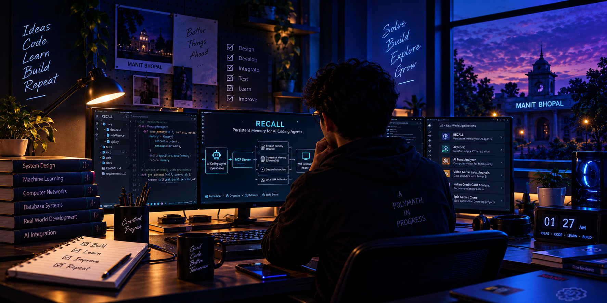

  
  

    
  

  
<strong>MCA @ MANIT Bhopal · Software Engineering · AI-Integrated Systems</strong>

  

    
  

  

    
    
  

  

## About Me

I'm pursuing my **MCA at MANIT Bhopal (2025–2028)**, focused on software engineering and AI-integrated systems. I enjoy building end-to-end solutions across application logic, APIs, data storage, and hardware integration.

Currently, I'm strengthening my software engineering foundations and learning **C#/.NET for Windows-native development**. I continue to use Python for DSA, backend development, automation, and AI experimentation.

## Current Focus

- **Software engineering:** architecture, maintainable code, testing, and system integration.
- **Windows development:** C#, .NET, WinUI 3, and WPF.
- **AI systems:** practical AI integration and persistent context for coding agents.

## Flagship Project — [RECALL](https://github.com/dp9318/RECALL)

  

    
    
  

  

    
  

  

    
  

**RECALL is a persistent memory engine for AI coding agents.** It preserves project knowledge, decisions, and developer instructions across sessions, making relevant context available to agents through the **Model Context Protocol (MCP)**.

- Persistent project memory, retrieval, and context assembly.
- Custom-instruction precedence, conflict handling, and memory lineage.
- MCP integration, API, and a separate web dashboard.

**My contributions:** system architecture, database design, memory orchestration, instruction precedence, context assembly, and integration testing. RECALL was developed collaboratively for **Agentia '26 — Software Track** and continues in active development.

**Stack:** Python · MCP · FastAPI · SQLite · ChromaDB · React · Tailwind CSS  
**Planned:** PostgreSQL · pgvector

## Other Featured Projects

<table>
  <tr>
    <td width="50%" valign="top">
      <h3>🌱 <a href="https://github.com/dp9318/AQIconic">AQIconic</a></h3>
      <strong>Environmental monitoring & hardware integration</strong>
      
A desktop application integrating ESP32 hardware, sensors, real-time communication, and a custom interface.

      <strong>Technologies:</strong> Python · Qt/QML · PySide6 · ESP32
    </td>
    <td width="50%" valign="top">
      <h3>🔬 <a href="https://github.com/dp9318/Liquid-Food-Analyzer">AI Food Analyzer</a></h3>
      <strong>Microscopic image analysis & computer vision</strong>
      
A research project exploring microscopic-image analysis and bacterial-pattern detection for food sample assessment.

      <em>Research prototype; not a certified diagnostic system.</em> 
      <strong>Technologies:</strong> Python · YOLO · Computer Vision
    </td>
  </tr>
  <tr>
    <td width="50%" valign="top">
      <h3>🎮 <a href="https://github.com/dp9318/Game-Sales-Analysis-1971-2024-">Video Game Sales Analysis</a></h3>
      <strong>Data analytics & visualization</strong>
      
A Power BI analysis of 50+ years of global video-game sales across platforms, genres, and regions.

      <strong>Technologies:</strong> Power BI · DAX
    </td>
    <td width="50%" valign="top">
      <h3>💳 <a href="https://github.com/dp9318/Indian-Credit-Card-Analysis">Indian Credit Card Analysis</a></h3>
      <strong>Spending analysis & recommendations</strong>
      
A Python project analyzing spending patterns to identify cards that may offer better value for different use cases.

      <strong>Technologies:</strong> Python · Data Analysis
    </td>
  </tr>
</table>

[Explore all repositories](https://github.com/dp9318?tab=repositories) · [Epic Games Clone](https://github.com/dp9318/Epic-Games-Clone)

## Technologies & Tools

| Area | Technologies |
|---|---|
| **Languages & data** | Python · SQL · Power BI · DAX |
| **AI, APIs & persistence** | MCP · FastAPI · REST APIs · SQLite · ChromaDB |
| **Desktop & hardware** | Qt/QML · PySide6 · ESP32 |
| **Currently learning** | C# · .NET · WinUI 3 · WPF |
| **Developer tools** | Git · GitHub |

## Experience

- **Data Analyst Intern — Ekara Financials:** data preparation, SQL, Power BI, and analytical workflows.
- **AI Prompt Writer & Evaluator — Outlier AI:** prompt creation, model-response evaluation, and structured quality feedback.

## GitHub Contributions

  

  <picture>
    <source media="(prefers-color-scheme: dark)" srcset="https://raw.githubusercontent.com/dp9318/dp9318/output/github-snake-dark.svg" />
    <source media="(prefers-color-scheme: light)" srcset="https://raw.githubusercontent.com/dp9318/dp9318/output/github-snake.svg" />
    
  </picture>

## Connect

  
  
  

  Thanks for stopping by — always learning, building, and improving.

