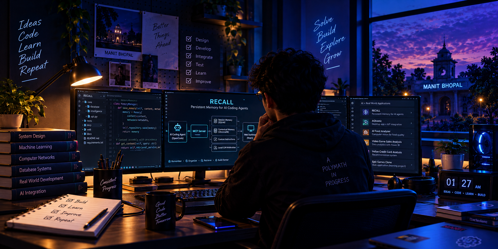

  

---

<h2>👋 About Me</h2>

I'm an MCA student at <b>MANIT Bhopal</b>, focused on
<b>software and application development with AI integration</b>.
I enjoy understanding a problem, learning the tools it requires, and
bringing different components together into useful, working software.

My experience spans desktop applications, software–hardware integration,
data analysis, and AI systems. I'm particularly interested in how application
logic, databases, APIs, persistent context, and AI capabilities work together
to solve real problems.

<ul>
  <li>🧩 Building software through problem-solving, implementation, and integration</li>
  <li>🤖 Exploring ways to make applications more useful through AI integration</li>
  <li>🖥️ Developing desktop applications with Python, Qt/QML, and PySide6</li>
  <li>🔌 Working with APIs, persistent storage, real-time communication, and hardware</li>
  <li>🛠️ Learning the technology a problem needs rather than limiting myself to one stack</li>
</ul>

<blockquote>
  <b>I learn what the problem needs and build it.</b>
</blockquote>

---

## 📊 GitHub Analytics

  

---

## 🚀 Featured Projects

<table>
<tr>
<td width="50%" valign="top">

<h3>🧠 <a href="https://github.com/dp9318/RECALL">RECALL</a></h3>

<b>Persistent memory engine for AI coding agents</b>

RECALL helps AI coding agents retain useful project context across sessions. It brings together persistent memory, context retrieval, custom-instruction precedence, MCP integration, and a separate web dashboard.

<b>My contributions:</b> System architecture, database design, core memory-management and orchestration, context-precedence handling, and integration of system components within a collaborative project.

<b>Technologies:</b> Python, SQLite, ChromaDB, MCP, FastAPI, React

</td>
<td width="50%" valign="top">

<h3>🌱 <a href="https://github.com/dp9318/AQIconic">AQIconic</a></h3>

<b>Desktop application and environmental hardware integration</b>

An environmental monitoring and control system integrating ESP32 hardware, sensors, real-time communication, an ultrasonic atomizer, and a custom Windows application.

<b>My focus:</b> Desktop application development and software–hardware integration.

<b>Technologies:</b> Python, Qt/QML, PySide6, ESP32, Socket.IO

</td>
</tr>
<tr>
<td width="50%" valign="top">

<h3>🔬 <a href="https://github.com/dp9318/Liquid-Food-Analyzer">AI Food Analyzer</a></h3>

<b>Microscopic image analysis and computer vision</b>

An ongoing project exploring microscopic image analysis and bacterial-pattern detection for food-related sample assessment.

Developed under the guidance of <b>Dr. Jay Kumar Jain</b>. This is a work in progress, not a certified or production-deployed diagnostic system.

<b>Technologies:</b> Python, YOLO, computer vision

</td>
<td width="50%" valign="top">

<h3>🎮 <a href="https://github.com/dp9318/Game-Sales-Analysis-1971-2024-">Video Game Sales Analysis</a></h3>

<b>Data analytics and visualization</b>

A Power BI analysis of more than 50 years of global video-game sales data, exploring platform, genre, regional, and market trends.

<b>Technologies:</b> Power BI, DAX

</td>
</tr>
</table>

### More Projects

- 💳 [Indian Credit Card Analysis](https://github.com/dp9318/Indian-Credit-Card-Analysis) — A Python-based analysis and recommendation system for identifying suitable credit cards from spending patterns.
- 🎮 [Epic Games Clone](https://github.com/dp9318/Epic-Games-Clone) — A pixel-inspired recreation of the Epic Games Store, built as a learning project.

---

## 🛠️ Technologies I Work With

<h3>💻 Languages & Data</h3>

  
  

<h3>🖥️ Application Development & Integration</h3>

  
  
  
  
  
  

<h3>🧠 AI Systems & Persistence</h3>

  
  
  
  

<h3>🔧 Tools & Supporting Experience</h3>

  
  
  

My technology choices are driven by project requirements. Machine learning,
computer vision, and data analytics remain part of my experience and ongoing
exploration, while software/application development with AI integration is
my primary direction.

---

## 🎯 Current Focus

- 🧩 Building stronger software engineering and application development skills
- 🤖 Integrating AI capabilities into practical software systems
- 🧠 Developing RECALL's memory-management and context-handling capabilities
- 🔗 Understanding how databases, APIs, application logic, and AI components fit together
- 🧪 Improving software reliability through testing, debugging, and integration

---

## 💼 Experience

- **Data Analyst Intern — Ekara Financials:** Practical experience with data preparation, SQL, Power BI, and analytical workflows.
- **AI Prompt Writer & Evaluator — Outlier AI:** Worked on prompt creation, model-response evaluation, and structured quality feedback.

These experiences contribute to my analytical background and understanding of AI systems. My current professional direction is software/application development with AI integration.

---

## 🌱 A Polymath in Progress

I've explored different areas of computing, from data analytics and desktop applications to hardware integration and AI.

I see that breadth as a way to understand how systems connect, not as a claim to expertise in every field. My goal is to keep building depth, learn what a problem genuinely needs, and turn that learning into working solutions.

---

## 🌐 Connect With Me

  
  
  

---

⭐ Thanks for stopping by!

